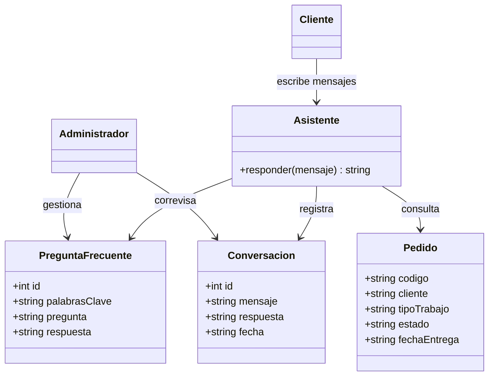

# Trazabilidad con los artefactos del ciclo del software

Este documento relaciona el módulo codificado con los artefactos elaborados antes. **Ajusta los códigos y nombres para que coincidan con los de tus propios artefactos** antes de entregar (estos son una referencia del módulo, no copias de tus documentos originales).

## Módulo codificado: Asistente Virtual de atención al cliente

Proyecto: chatbot de respuesta del Laboratorio Dental Genesis (aplicación web).

## Historias de usuario

| Código | Historia | Dónde se implementa |
|---|---|---|
| HU-01 | Como cliente, quiero preguntar por horarios, servicios, tiempos y precios para obtener respuesta inmediata. | `POST /chat`, `chatbot.py`, vista de chat |
| HU-02 | Como cliente, quiero consultar el estado de mi pedido con su código para saber cuándo recogerlo. | `chatbot.responder`, `GET /pedidos/<codigo>` |
| HU-03 | Como administrador, quiero crear, editar y eliminar preguntas frecuentes para mantener actualizado al asistente. | `/faqs` (CRUD), panel de preguntas frecuentes |
| HU-04 | Como administrador, quiero revisar el historial de conversaciones para mejorar el servicio. | `GET /conversaciones`, tabla `conversaciones` |

## Casos de uso

| Código | Caso de uso | Actor |
|---|---|---|
| CU-01 | Consultar información general | Cliente |
| CU-02 | Consultar estado de pedido | Cliente |
| CU-03 | Gestionar preguntas frecuentes | Administrador |
| CU-04 | Consultar historial de conversaciones | Administrador |

## Diagrama de clases (módulo)

Correspondencia con el código: `Asistente` → `chatbot.py`; `PreguntaFrecuente`, `Pedido`, `Conversacion` → tablas `faqs`, `pedidos`, `conversaciones` en `schema.sql`.

## Diseño / prototipo

La interfaz (`templates/index.html`, `static/css/styles.css`) retoma la identidad visual definida en las evidencias anteriores: paleta azul petróleo + ámbar, tipografías Space Grotesk e Inter, diseño responsive.

## Estándares de codificación aplicados

- **Python:** PEP 8 (snake_case para funciones y variables, docstrings, líneas de máximo 100 caracteres).
- **JavaScript:** Google JavaScript Style Guide (`const`/`let`, camelCase, comillas simples, JSDoc, 2 espacios).
- **HTML/CSS:** recomendaciones W3C/MDN (HTML5 semántico, variables CSS, nombres de clases en minúscula).
- **Base de datos:** tablas en plural y snake_case.
